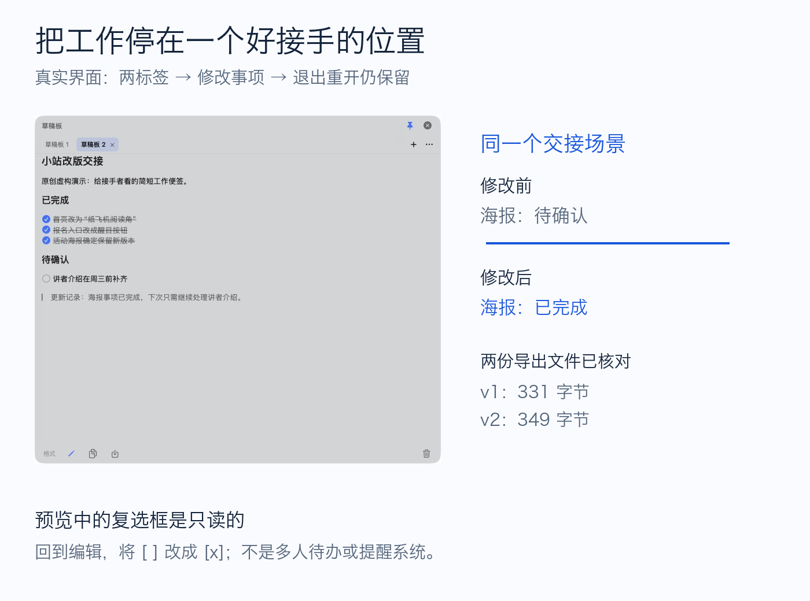

# 让临时想法有个能接着写的地方

这是 RepoGo 为 [Vorssaint Utils](https://github.com/vorssaint/vorssaint-utils) 编写的中文上手资料。原项目是一个按需安装功能的 Mac 菜单栏工具箱；本期聚焦其中的**草稿板**：多标签速记、Markdown 预览、文本导出和自动保存。

临时想法和正式文档之间，往往缺一个放得下、找得到的中间站。活动安排还没想全，不必先搭一个知识库；手头工作做到一半，也可以先把“做完什么、还差什么”留在一张便签里。草稿板的价值在于这个轻量的入口，而不是替你完成活动策划或项目管理。

## 两个可以照着做的场景

**把活动想法整理成草稿。** 新建第一个标签，写下读书会的地点、时间和准备事项。使用 `#` 标记标题、`-` 写列表，点底部的眼睛切到预览。Markdown 是用少量符号表达标题、列表等排版的纯文本写法。你得到的是一份有层次的活动草稿；导出后也能放进其他编辑器继续写。

**给下一次开工留一份交接。** 第二个标签分别写“已完成”和“待确认”。示例中，海报从待确认改为已完成；重新导出的文件也包含了这一变化。它适合个人收尾便签、临时交接提纲，不具备本次未验证的多人协作、提醒或云同步能力。

`samples/handoff-v1.txt` 和 `handoff-v2.txt` 是软件实际导出的两个文件，均为原创虚构内容。修改不是新增场景，两份文件用于展示同一场景的更新过程。

## 从哪里开始

- [首次使用与官方入口](START_HERE.md)
- [运行、停止、更新和备份](RUN.md)
- [本次遇到的问题](FAQ.md)
- [项目定位与能力边界](PRODUCT.md)
- [来源、许可与素材](ATTRIBUTION.md)

**系统门槛：Apple Silicon Mac，macOS 14 或更高版本。Windows、Linux 不受上游支持，本资料没有相应启动器。** 简体中文是原软件自带的能力，RepoGo 补充的是中文用法、虚构练习材料和实跑排坑。

## 本次实际做到哪一步

2026-11-02 在 Apple Silicon Mac 上使用官方 v3.4.3：空白草稿板中新建两标签、输入中文、切换真实预览、导出文件、修改并再次导出；正常退出重启后，两标签和修改内容仍在。导出文件保留 Markdown 符号，并非排版后的 PDF。没有进行长期耐久测试，也没有测 Intel Mac、Windows、Linux。

本仓库只交付原创资料、启动辅助脚本、虚构样例和实跑截图，不提供软件安装包、源码镜像、修改版或官方品牌重打包。下载始终指向原作者的官方发布页。RepoGo 是独立教程整理者，与原项目无隶属或背书关系。
