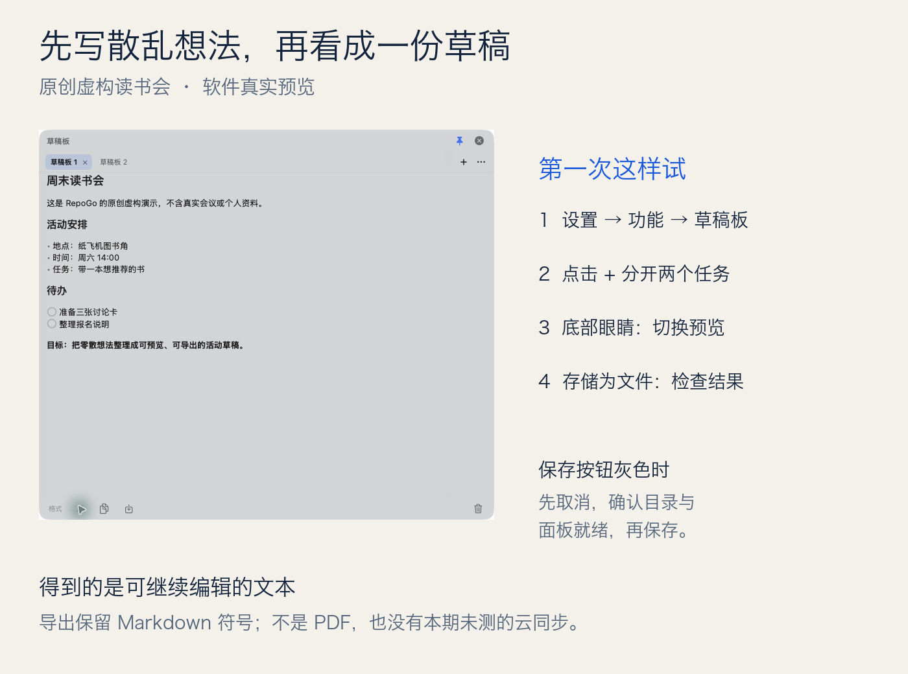

# 第一次打开：先只用草稿板

先确认你的电脑是 Apple Silicon Mac，系统至少 macOS 14。Intel Mac、Windows 和 Linux 不适用本期软件。

1. 打开原作者的 [v3.4.3 发布页](https://github.com/vorssaint/vorssaint-utils/releases/tag/v3.4.3)，下载 `Vorssaint-3.4.3.dmg`。后续新版请另行核对要求，不把本期资料当作新版测试记录。
2. 按官方方式将应用放入“应用程序”，打开它。它是菜单栏应用，入口在屏幕顶部，不要只在程序坞寻找。
3. 打开“设置 → 功能”，只找到并安装“草稿板”。这里的“安装”是启用程序内的一个功能，不是另行下载模型或新建账号。
4. 点左侧“草稿板 → 打开草稿板”。本次新功能初始为空；你已有笔记时先自行备份，不要用示例覆盖它们。
5. 写入 `samples/reading-club.txt` 的虚构内容。`#` 后面加空格是标题，`- [ ]` 是未完成事项。点底部眼睛图标，确认能看到标题和列表。
6. 点标签栏 `+`，在第二标签写入 `samples/handoff-v1.txt`。两个标签各自保留内容，适合把不同临时任务分开。
7. 点底部“存储为文件”，选择你自己的目录与新文件名；只有“保存”可点击时才提交。用文本编辑器打开文件，核对内容。输出是保留 Markdown 符号的 `.txt`，不是 PDF。



## 窗口一失焦就消失

默认可开启“点击外部时关闭”。本次自动化点击时遇到浮窗关闭，未写入内容。我们在“设置 → 草稿板”将该选项关闭，再重新打开草稿板完成输入。你也可以按自己的习惯使用顶部图钉；确认状态后再写，不要把窗口关闭误认为内容丢失。

## 不必为草稿板打开一整套权限

本次只添加草稿板，没有开启剪贴板历史、账号监听、录屏、麦克风或辅助功能，也没有开启登录启动和全局草稿板快捷键。其他模块有各自权限要求。你只需要便签时，先不要点“全部安装”。出现新权限或管理员提示时，先确认它来自哪个功能；本资料没有要求为草稿板绕过系统保护。

## 辅助启动入口

`start.command` 是 RepoGo 编写的本地辅助入口：检查系统、应用版本及官方签名，然后打开已经安装的应用。它不下载或安装软件，不绕过 Gatekeeper。可以双击；若系统要求你先检查脚本，可用终端：

```bash
bash start.command /Applications/Vorssaint.app
```

未安装应用时，它只给出官方发布页和下一步。首次安装仍是上面的官方手动步骤，因此本资料不称“全程一键部署”。
